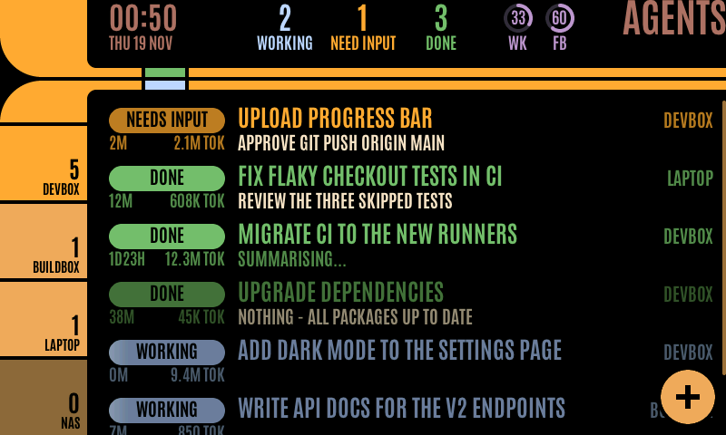
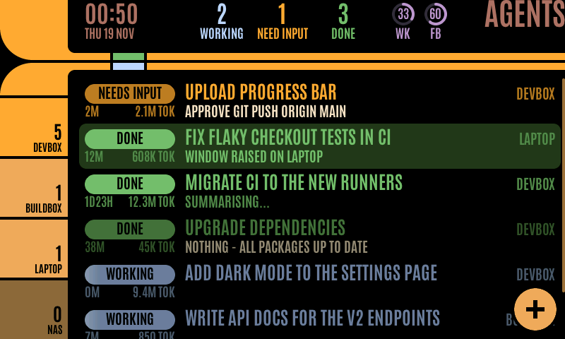
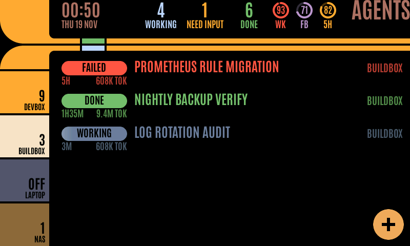
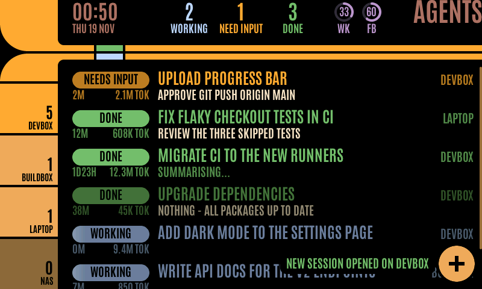

# Agent Control

A desk display of every Claude Code session running on your machines, so you can see
at a glance which ones are working, which are waiting for you, and which have
finished and want their result checked. Tap a session to bring its terminal window
to the front; tap **+** to start a new one.

It runs on a **Waveshare ESP32-S3-Touch-LCD-7** (a 7" 800×480 touch screen with an
ESP32-S3 on the back) in an LCARS-inspired style, fed by a small hub that watches the
sessions on each of your machines with `claude agents --json`.


| | |
|---|---|
|  |  |
| **Needs input**: the session waiting on a permission prompt goes to the top and its pill pulses; the frame turns amber. Under each finished session, a line of what is left for you to do. | **Tap a row** and the hub raises that session's terminal window on its machine. |
|  |  |
| **Tap a machine** in the left-hand leg to list only its sessions. | **+** opens a new Claude Code session on your desktop. |

The screenshots come from the simulator in `firmware/sim`, which compiles the
firmware's own UI code on the desktop, so they are what the panel shows.

## What it shows

- **One row per live session**: its state, how long it has been in that state, the
  tokens it has used, its title and machine. Sessions waiting for you come first, then
  finished ones (latest first), then those working, then new sessions nobody has used
  yet.
- **What is left for you to do**: for a finished or waiting session, a one-line
  summary of what it needs from you ("APPROVE GIT PUSH ORIGIN MAIN"), written by
  Claude Haiku from the session's last turn. Rows with nothing for you to do are
  dimmed.
- **Counts** of sessions working, needing input and done; a block per machine with
  its count (OFF when unreachable); optional ring gauges for the Claude plan's usage.
- The backlight stays on while anything is working, waiting or done, and turns off
  30 minutes after that; a touch wakes it.
- Optional: three WS2812B LEDs above the screen that light up with the three counts.

## How it works

```
 Waveshare display ──long poll──▶ hub (FastAPI, :8767) ──▶ claude agents --json on this machine
        ▲   taps: /api/focus, /api/new        │
        └─────────────────────────────────────┴──ssh──▶ claude agents --json on your other machines
```

- **`hub/`** (Python): runs a small probe on each machine every 3 seconds: locally
  for its own machine, over SSH for the others (the probe script is piped to
  `python3`, nothing is installed there). It merges the results and serves them to the
  display, holding each request until something changes. See [hub/README.md](hub/README.md).
- **`firmware/`** (C, ESP-IDF + LVGL, built with PlatformIO): draws the screen, sends
  taps back to the hub, updates itself over Wi-Fi. See [firmware/README.md](firmware/README.md).

The display only holds a shared device key; it never talks to your machines or to
Anthropic directly.

## Setting it up with a new Waveshare board

### What you need

- A **Waveshare ESP32-S3-Touch-LCD-7** (800×480; the plain "7" model, whose pins
  this firmware uses) and a USB-C data cable.
- A **2.4 GHz Wi-Fi network** (the ESP32-S3 has no 5 GHz radio).
- A Linux machine that is on whenever you want the display working, to run the hub.
  It needs Python 3.10+ and the Claude Code CLI, and SSH access (key-based, no
  prompt) to each other machine you want shown.
- **Claude Code** on every machine you want shown, recent enough to have
  `claude agents --json` (run it: it should print a JSON array).
- A computer with **PlatformIO** to build and flash the firmware (it can be the same
  machine).

### 1. Start the hub

On the always-on machine:

```bash
git clone https://github.com/chrisbeach/claude-agent-control.git ~/claude-agent-control
cd ~/claude-agent-control/hub
python3 -m venv .venv                  # Debian/Ubuntu: sudo apt install python3-venv first
.venv/bin/pip install -r requirements.txt

# the shared secret between the hub and the display
mkdir -p ~/.config/agent-control
python3 -c "import secrets; print(secrets.token_urlsafe(24))" > ~/.config/agent-control/device_key
chmod 600 ~/.config/agent-control/device_key

cp .env.example .env
```

Edit `.env`: set `AGENT_CONTROL_HOSTS` to the machines to show, in the order you want
their blocks on the screen, e.g. `AGENT_CONTROL_HOSTS=devbox,laptop` (the hub's own
machine is read directly; for each of the others, `ssh <name> true` must work without
a prompt). The other settings (the **+** button, tap-to-raise, usage gauges) can wait.

```bash
./run.sh
```

From a second terminal, check that it sees your sessions:

```bash
curl -s localhost:8767/healthz
curl -s -H "Authorization: Bearer $(cat ~/.config/agent-control/device_key)" localhost:8767/api/fleet
```

To keep it running, install the systemd user unit in `hub/examples/agent-control.service`
(instructions are in the file). If the machine has a firewall, open TCP port 8767 to
the display.

Optional, on each other machine with Python 3.10+: `./bootstrap-host.sh laptop` gives
its probe the Claude Agent SDK, so its sessions show titles, to-do lines and the
done/idle distinction rather than just their names. Restart the hub afterwards.

### 2. Install PlatformIO

On the computer you will flash from:

```bash
pipx install platformio        # or: python3 -m pip install --user platformio
```

(or install the PlatformIO extension in VS Code). On Linux, let your user open the
board's serial port, then log out and back in:

```bash
sudo usermod -aG dialout "$USER"
curl -fsSL https://raw.githubusercontent.com/platformio/platformio-core/develop/platformio/assets/system/99-platformio-udev.rules \
    | sudo tee /etc/udev/rules.d/99-platformio-udev.rules
sudo udevadm control --reload-rules && sudo udevadm trigger
```

### 3. Configure the firmware

```bash
cd ~/claude-agent-control/firmware
cp secrets.ini.example secrets.ini
```

Fill in `secrets.ini`:

- `wifi_ssid`, `wifi_password`: your 2.4 GHz network.
- `hub_url`: `http://<the hub machine's LAN IP>:8767`. A fixed IP (a DHCP
  reservation on your router) is safest.
- `device_key`: the contents of `~/.config/agent-control/device_key` on the hub machine.
- `hostname`: the board's network name; `agent-display` is fine for one board.
- `timezone`: a POSIX TZ string for the clock (examples in the file; default UTC).
- `rotate_180 = 1` if your case or stand holds the board upside down.

### 4. Flash it over USB

Plug the board into your computer. It should appear as an Espressif USB JTAG/serial
device (`lsusb` shows `303a:1001`), on `/dev/ttyACM0` on Linux or
`/dev/cu.usbmodem*` on macOS. Then:

```bash
pio run -t upload                          # the first build also downloads ESP-IDF, LVGL and friends
# if it picks the wrong port: pio run -t upload --upload-port /dev/ttyACM0
```

When the upload finishes, **unplug the board and plug it back in** (after a USB flash
the chip can stay in its ROM download mode: backlight on, screen black). It should
then show JOINING WI-FI, then CONTACTING THE HUB, then your sessions. To watch its
log over USB: `pio device monitor`.

### 5. Check it, and update it over Wi-Fi from now on

```bash
curl -s http://agent-display.local/status         # build, IP, uptime
pio run -t ota                                     # build and push a new firmware over Wi-Fi
OTA_HOST=192.168.1.50 pio run -t ota               # if .local names do not resolve on your network
```

A new firmware that cannot reach the hub within 10 minutes rolls itself back to the
previous one, so a bad `secrets.ini` cannot leave the board stranded once it has been
flashed over USB with a working one.

### If something is wrong

| The screen shows | Likely cause |
|---|---|
| Black screen, backlight on, after a USB flash | ROM download mode: unplug and replug the board. |
| JOINING WI-FI, for ever | Wrong SSID or password, or a 5 GHz-only network. |
| CONTACTING THE HUB, then NO LINK TO THE HUB | `hub_url` is wrong, the hub is not running, or a firewall blocks port 8767. |
| HUB ERROR: WRONG DEVICE KEY | `device_key` does not match the hub's key file. |
| A machine's block says OFF | The hub cannot run `ssh <name>` non-interactively, or `claude` is not found there: see `curl localhost:8767/healthz` on the hub. |
| Tapping a row says WINDOW SWITCHING IS NOT SET UP ON THE HUB | Expected until you set `AGENT_CONTROL_FOCUS_COMMAND`: see below. |

## Optional extras

All are hub settings in `hub/.env` (restart the hub after changing them); details in
[hub/README.md](hub/README.md).

- **+ opens a new session**: set `AGENT_CONTROL_NEW_SESSION_HOST` and
  `AGENT_CONTROL_NEW_SESSION_LAUNCHER` to a machine with a Linux desktop and a
  `.desktop` launcher that opens a terminal running `claude`
  (`hub/examples/claude-terminal.desktop` is a starting point).
- **Tap raises the window**: set `AGENT_CONTROL_FOCUS_COMMAND` to a command that
  brings a session's terminal to the front, given its session id or process id. How
  to do that depends on your desktop (X11, tmux, a GNOME Shell extension on Wayland),
  so none is included.
- **What's left to do lines** are on by default when the hub machine has the `claude`
  CLI: one short Claude Haiku call on your plan per finished turn. Set
  `AGENT_CONTROL_CLAUDE=` (empty) to turn them off.
- **Usage gauges**: point `AGENT_CONTROL_PROMETHEUS` at a Prometheus server that
  holds `claude_allowance_used_percent{window=...}` from an exporter of your own.
- **Status LEDs**: three WS2812B LEDs on the board's spare GPIO; see
  [firmware/README.md](firmware/README.md#optional-status-leds).

## Security

The hub's API and the board's update, screenshot and tap pages are protected by the
device key, sent as a bearer token over **plain HTTP**: keep both on a network you
trust. Anyone with the key can see your session titles, raise windows and open
sessions on your desktop, and flash the board. Besides SSH to the machines you list,
the hub only runs `claude agents --json`, the Agent SDK's transcript readers,
`claude -p` for the to-do lines, your configured focus command and the launcher;
session ids and process ids are validated before they reach a shell.

## Licence

Apache License 2.0; see [LICENSE](LICENSE). The bundled Antonio font is under the
SIL Open Font License 1.1 ([firmware/shared/fonts/OFL.txt](firmware/shared/fonts/OFL.txt)).
LCARS is the fictional computer interface of *Star Trek*; this is a fan-style homage,
not affiliated with or endorsed by its owners.
