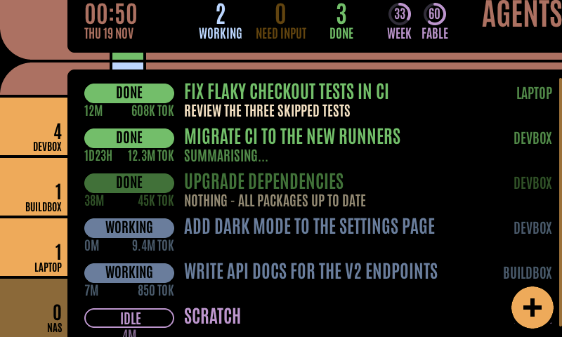
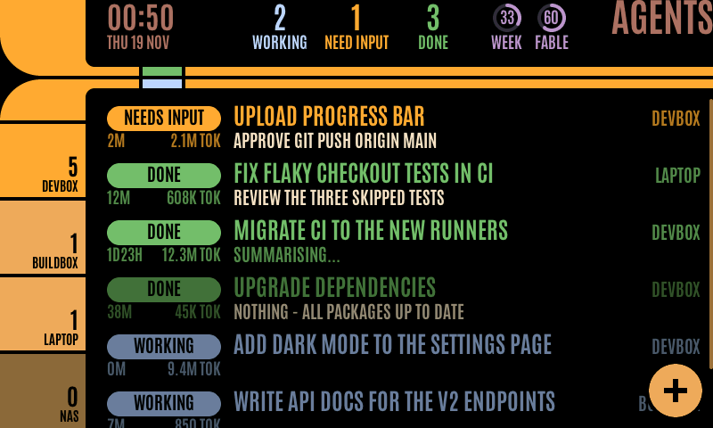
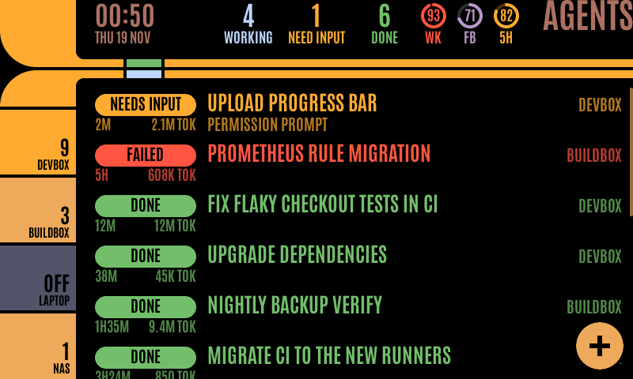

# Agent Control

A desk display of every Claude Code session running on your machines, so you can see
at a glance which ones are working, which are waiting for you, and which have
finished and want their result checked. Tap a session to bring its terminal window
to the front; tap **+** to start a new one.

It runs on a **[Waveshare ESP32-S3-Touch-LCD-7](https://link.amazon/B098TS2q7)** (a 7"
800×480 touch screen with an ESP32-S3 on the back) in an LCARS-inspired style, fed by a
small hub that watches the sessions on each of your machines with `claude agents --json`.

<sub>The board links in this README are Amazon affiliate links: as an Amazon Associate
I earn from qualifying purchases.</sub>



<table>
<tr>
<td width="50%"></td>
<td width="50%"></td>
</tr>
<tr>
<td width="50%" valign="top"><strong>Needs input</strong>: the session waiting on a permission prompt goes to the top and its pill pulses; the frame turns amber. Under each finished session, a line of what is left for you to do.</td>
<td width="50%" valign="top"><strong>Tap a row</strong> and the hub raises that session's terminal window on its machine; the row says so, then goes back to normal.</td>
</tr>
<tr>
<td width="50%"></td>
<td width="50%"></td>
</tr>
<tr>
<td width="50%" valign="top"><strong>Tap a machine</strong> in the left-hand leg to list only its sessions; tap it again to list them all.</td>
<td width="50%" valign="top"><strong>+</strong> opens a new Claude Code session on your desktop.</td>
</tr>
</table>

These animations come from the simulator in `firmware/sim`, which compiles the
firmware's own UI code on the desktop and taps it through a simulated touch screen,
so they are what the panel shows; the white circle marks where the finger touched.

## What it shows

- **One row per live session**: its state, how long it has been in that state, the
  tokens it has used, its title and machine. Sessions waiting for you come first, then
  finished ones (latest first), then those working, then new sessions nobody has used
  yet.
- **What is left for you to do**: for a finished or waiting session, a one-line
  summary of what it needs from you ("APPROVE GIT PUSH ORIGIN MAIN"), written by
  Claude Haiku from the session's last turn. Rows with nothing for you to do are
  dimmed.
- **Counts** of sessions working, needing input and done; a block per machine with
  its count (OFF when unreachable); optional ring gauges for the Claude plan's usage.
- The backlight stays on while anything is working, waiting or done, and turns off
  30 minutes after that; a touch wakes it. The panel can also be switched off and on
  with your monitors (see [Optional extras](#optional-extras)).
- Optional: three WS2812B LEDs above the screen that light up with the three counts.

## How it works


- **`hub/`** (Python): runs a small probe on each machine every 3 seconds: locally
  for its own machine, over SSH for the others (the probe script is piped to
  `python3`, nothing is installed there). It merges the results and serves them to the
  display, holding each request until something changes. See [hub/README.md](hub/README.md).
- **`firmware/`** (C, ESP-IDF + LVGL, built with PlatformIO): draws the screen, sends
  taps back to the hub, updates itself over Wi-Fi. See [firmware/README.md](firmware/README.md).
- **`desktop/`** (a GNOME Shell extension and a Python helper; optional): for a
  machine with a GNOME desktop, the command a tap runs there, which brings the
  session's terminal window to the front and marks it, and a launcher for the **+**.
  See [desktop/README.md](desktop/README.md).

The display only holds a shared device key; it never talks to your machines or to
Anthropic directly.

## Setting it up with a new Waveshare board

### What you need

- A **[Waveshare ESP32-S3-Touch-LCD-7](https://link.amazon/B098TS2q7)** (800×480; the
  plain "7" model, whose pins this firmware uses) and a USB-C data cable.
- A **2.4 GHz Wi-Fi network** (the ESP32-S3 has no 5 GHz radio).
- A Linux machine that is on whenever you want the display working, to run the hub.
  It needs Python 3.10+ and the Claude Code CLI, and SSH access (key-based, no
  prompt) to each other machine you want shown.
- **Claude Code** on every machine you want shown, recent enough to have
  `claude agents --json` (run it: it should print a JSON array). Each of the other
  machines also needs a `python3` for the hub's probe, which need not be 3.10 (the
  probe has been run on Python 3.9). A Mac can be one of them: its sessions are shown
  like any other machine's, but nothing in this repository raises a window or opens a
  session on macOS (see [hub/README.md](hub/README.md#install-and-run)).
- A computer to build and flash the firmware from, over USB: Linux or macOS, with
  `git` and Python 3.10+ (on Debian and Ubuntu, also `sudo apt install python3-venv`).
  It can be the same machine. The firmware is built with **PlatformIO**, which
  `install.sh` installs there.

### Install

On the always-on machine, with the board plugged into it by USB:

```bash
git clone https://github.com/chrisbeach/claude-agent-control.git ~/claude-agent-control
~/claude-agent-control/install.sh
```

`install.sh` asks a few questions (which machines to show, your Wi-Fi name and
password, the time zone) and does the rest:

1. **The hub**: its Python packages in `hub/.venv`, a device key (the secret the hub
   and the display share), `hub/.env`, a check that `ssh` reaches each other machine
   and the Claude Agent SDK for them, and a systemd user service that keeps the hub
   running. It ends by listing each machine and the sessions the hub sees there.
2. **The firmware**: PlatformIO, `firmware/secrets.ini` from your answers, the build
   (the first one downloads about 2 GB of ESP-IDF and compilers and takes several
   minutes), and the flash over USB. When it has flashed, **unplug the board and plug
   it back in**: it should show JOINING WI-FI, then CONTACTING THE HUB, then your
   sessions.

If the board is plugged into a different computer from the hub's, run the two halves
where they belong: `./install.sh hub` on the always-on machine, then
`./install.sh firmware` on the other, which asks for the hub's address and device key.

Things to know about it:

- **It is safe to run again**, for instance after a `git pull`: an existing device
  key, `hub/.env` and `firmware/secrets.ini` are kept, never overwritten. To be asked
  the firmware questions again, delete `firmware/secrets.ini`.
- **It does not use sudo**, with one exception it asks about first: on Linux, if you
  may not write to the board's serial port, PlatformIO's udev rules. Where something
  else needs root (a missing package, a firewall port), it prints the command for
  your distribution and leaves it to you.
- **Python**: it takes the first `python3` or `python3.N` at 3.10 or later, on your
  `PATH` or where Homebrew puts one, so a default `python3` that is too old (a Mac's
  own is 3.9) is no obstacle. On Debian and Ubuntu the hub does not need
  `python3-venv`; PlatformIO does.
- **PlatformIO** goes into a directory of its own,
  `~/.local/share/agent-control/platformio`, at the one core version the firmware's
  platform builds with (the current PlatformIO does not build it), so a PlatformIO
  you already have is neither used nor touched. `firmware/pio` runs it: after
  `install.sh`, type `./pio` wherever these pages say `pio`.
- **Wi-Fi names and passwords** cannot be carried into the build when they have a
  quote, a backslash, a `$` or one of `; & | < > ( ) { }` in them
  (`firmware/secrets.ini.example` has the full list): it says so, rather than flash
  a board that would never join.
- **No systemd user session** (macOS, a container, WSL without systemd): the hub is
  set up but not started; the script prints the command to run, to keep running in
  whatever way suits the machine.
- **On a Mac** it offers the firmware only, unless you ask for the hub: the hub is
  untested there.
- **Unattended**: `--yes` takes the default answer to every yes/no question, and each
  answer can be given in the environment (`AC_HOSTS`, `AC_WIFI_SSID`,
  `AC_WIFI_PASSWORD` and the rest: `./install.sh --help` lists them).

The hub half has been run on Ubuntu 22.04 to 26.04, Debian 12, Fedora, Arch, Alpine,
openSUSE Leap and macOS (Apple Silicon); the firmware half, up to the finished
build, from nothing on Ubuntu 24.04, with and without another PlatformIO there.

<details>
<summary><strong>Manual installation</strong>: the same steps, by hand</summary>

#### 1. Start the hub

On the always-on machine (not the Waveshare):

```bash
git clone https://github.com/chrisbeach/claude-agent-control.git ~/claude-agent-control
cd ~/claude-agent-control/hub
python3 -m venv .venv                  # Debian/Ubuntu: sudo apt install python3-venv first
.venv/bin/pip install -r requirements.txt

# the shared secret between the hub and the display
mkdir -p ~/.config/agent-control
python3 -c "import secrets; print(secrets.token_urlsafe(24))" > ~/.config/agent-control/device_key
chmod 600 ~/.config/agent-control/device_key

cp .env.example .env
```

Edit `.env`: set `AGENT_CONTROL_HOSTS` to the machines to show, in the order you want
their blocks on the screen, e.g. `AGENT_CONTROL_HOSTS=devbox,laptop` (the hub's own
machine is read directly; for each of the others, `ssh <name> true` must work without
a prompt). The other settings (the **+** button, tap-to-raise, usage gauges) can wait.

```bash
./run.sh
```

From a second terminal, check that it sees your sessions:

```bash
curl -s localhost:8767/healthz
curl -s -H "Authorization: Bearer $(cat ~/.config/agent-control/device_key)" localhost:8767/api/fleet
```

To keep it running, install the systemd user unit in `hub/examples/agent-control.service`
(instructions are in the file). If the machine has a firewall, open TCP port 8767 to
the display.

Optional, for each other machine: `./bootstrap-host.sh laptop` gives its probe the
Claude Agent SDK, so its sessions show titles, to-do lines and the done/idle
distinction rather than just their names. It needs a Python 3.10 or later on that
machine, which need not be its default `python3` (a Mac's own is 3.9; Homebrew's will
do): [hub/README.md](hub/README.md#titles-on-other-machines) says where the script
looks. Restart the hub afterwards.

#### 2. Install PlatformIO

On the computer you will flash from:

```bash
python3 -m venv ~/.platformio/penv          # Python 3.10 or later; git is needed too
~/.platformio/penv/bin/pip install pioarduino==6.1.19
ln -s ~/.platformio/penv/bin/pio ~/.local/bin/pio    # or any directory on your PATH
```

That is pioarduino's build of PlatformIO core, at the version the platform named in
`firmware/platformio.ini` builds with. The current PlatformIO (6.2) does not build
it: if that is the one you have, leave it be and let `./install.sh firmware` set up
its own copy beside it. On Linux, let your user open the
board's serial port, then log out and back in:

```bash
sudo usermod -aG dialout "$USER"
curl -fsSL https://raw.githubusercontent.com/platformio/platformio-core/develop/platformio/assets/system/99-platformio-udev.rules \
    | sudo tee /etc/udev/rules.d/99-platformio-udev.rules
sudo udevadm control --reload-rules && sudo udevadm trigger
```

#### 3. Configure the firmware

```bash
cd ~/claude-agent-control/firmware
cp secrets.ini.example secrets.ini
```

Fill in `secrets.ini`:

- `wifi_ssid`, `wifi_password`: your 2.4 GHz network. Some characters cannot be used
  in them: the file says which.
- `hub_url`: `http://<the hub machine's LAN IP>:8767`. A fixed IP (a DHCP
  reservation on your router) is safest.
- `device_key`: the contents of `~/.config/agent-control/device_key` on the hub machine.
- `hostname`: the board's network name; `agent-display` is fine for one board.
- `timezone`: a POSIX TZ string for the clock (examples in the file; default UTC).
- `rotate_180 = 1` if your case or stand holds the board upside down.

#### 4. Flash it over USB

Plug the board into your computer. It should appear as an Espressif USB JTAG/serial
device (`lsusb` shows `303a:1001`), on `/dev/ttyACM0` on Linux or
`/dev/cu.usbmodem*` on macOS. Then:

```bash
pio run -t upload                          # the first build also downloads ESP-IDF, LVGL and friends
# if it picks the wrong port: pio run -t upload --upload-port /dev/ttyACM0
```

When the upload finishes, **unplug the board and plug it back in** (after a USB flash
the chip can stay in its ROM download mode: backlight on, screen black). It should
then show JOINING WI-FI, then CONTACTING THE HUB, then your sessions. To watch its
log over USB: `pio device monitor`.

</details>

### Check it, and update it over Wi-Fi from now on

```bash
curl -s http://agent-display.local/status         # build, IP, uptime
cd ~/claude-agent-control/firmware
./pio run -t ota                                   # build and push a new firmware over Wi-Fi
OTA_HOST=192.168.1.50 ./pio run -t ota             # if .local names do not resolve on your network
```

(`./pio` is the PlatformIO that `install.sh` set up; with one you installed by hand,
it is plain `pio`.)

A new firmware that cannot reach the hub within 10 minutes rolls itself back to the
previous one, so a bad `secrets.ini` cannot leave the board stranded once it has been
flashed over USB with a working one.

When a `git pull` changes `firmware/sdkconfig.defaults`, delete
`firmware/sdkconfig.waveshare7` before the next build: the first build generates it
from the defaults and later builds keep its old values.

### If something is wrong

| The screen shows | Likely cause |
|---|---|
| Black screen, backlight on, after a USB flash | ROM download mode: unplug and replug the board. |
| JOINING WI-FI, for ever | Wrong SSID or password, a 5 GHz-only network, or a name or password with a character `secrets.ini` cannot carry (`firmware/secrets.ini.example` lists them). |
| CONTACTING THE HUB, then NO LINK TO THE HUB | `hub_url` is wrong, the hub is not running, or a firewall blocks port 8767. |
| HUB ERROR: WRONG DEVICE KEY | `device_key` does not match the hub's key file. |
| Nothing: it is dark, and a touch does not wake it | If the board still answers `curl -s http://agent-display.local/status`, it may have been switched off with `/screen?on=0` (`GET /screen` then says `off`, and `/status` says `"backlight": false`): `POST /screen?on=1`, or a restart, switches it back on. See [Optional extras](#optional-extras). |
| A machine's block says OFF | The hub cannot run `ssh <name>` non-interactively, or `claude` is not found there: see `curl localhost:8767/healthz` on the hub. |
| Tapping a row says WINDOW SWITCHING IS NOT SET UP ON THE HUB | Expected until you set `AGENT_CONTROL_FOCUS_COMMAND`: for a GNOME desktop, see [desktop/README.md](desktop/README.md) (its own table covers the messages after that); otherwise see [Optional extras](#optional-extras). |

## Optional extras

All but the last two are hub settings in `hub/.env` (restart the hub after changing
them); details in [hub/README.md](hub/README.md).

- **+ opens a new session**: set `AGENT_CONTROL_NEW_SESSION_HOST` and
  `AGENT_CONTROL_NEW_SESSION_LAUNCHER` to a machine with a Linux desktop and a
  `.desktop` launcher there that opens a terminal running `claude`. On a GNOME
  desktop, `desktop/install.sh` writes one, `agent-control-new`, whose terminal is
  raised and marked as it opens; elsewhere, `hub/examples/claude-terminal.desktop` is
  a starting point.
- **Tap raises the window**: set `AGENT_CONTROL_FOCUS_COMMAND` to a command that
  brings a session's terminal to the front, given its session id or process id (and
  the row's state and title, if it uses them). On a GNOME desktop (Wayland or X11),
  `desktop/install.sh` installs one that raises the window and marks it in the colour
  of the session's state, with its title: see [desktop/README.md](desktop/README.md).
  On other desktops the command is yours to write (on X11, say, with `wmctrl` or
  `xdotool`; under tmux, `tmux switch-client`).

  

  Three taps on a GNOME desktop: each window comes to the front and keeps a mark in
  its state's colour (green DONE, amber NEEDS INPUT, pale blue WORKING) until the
  focus moves on.
- **What's left to do lines** are on by default when the hub machine has the `claude`
  CLI: one short Claude Haiku call on your plan per finished turn. Set
  `AGENT_CONTROL_CLAUDE=` (empty) to turn them off.
- **Usage gauges**: point `AGENT_CONTROL_PROMETHEUS` at a Prometheus server that
  holds `claude_allowance_used_percent{window=...}` from an exporter of your own.
- **Status LEDs**: three WS2812B LEDs on the board's spare GPIO; see
  [firmware/README.md](firmware/README.md#optional-status-leds).
- **Off with your monitors**: the board's `/screen` page switches the panel off
  (backlight and LEDs dark, touches ignored) and back on, so a "screens off" button or
  script that darkens a room's monitors can darken the display too:

  ```bash
  curl -X POST -H "Authorization: Bearer <device key>" "http://agent-display.local/screen?on=0"
  ```

  `on=1` switches it back on, and so does a restart; sessions are still followed while
  it is off. See [firmware/README.md](firmware/README.md#over-the-air-updates-and-the-boards-own-pages).

## Security

The hub's API and the board's update, screenshot, tap, screen and LED pages are
protected by the device key, sent as a bearer token over **plain HTTP**: keep both on
a network you trust. Anyone with the key can see your session titles, raise windows
and open sessions on your desktop, and flash the board. Besides SSH to the machines
you list, the hub only runs `claude agents --json`, the Agent SDK's transcript
readers, `claude -p` for the to-do lines, your configured focus command and the
launcher; session ids and process ids are validated before they reach a shell.

## Licence

Apache License 2.0; see [LICENSE](LICENSE). The bundled Antonio font is under the
SIL Open Font License 1.1 ([firmware/shared/fonts/OFL.txt](firmware/shared/fonts/OFL.txt)).
LCARS is the fictional computer interface of *Star Trek*; this is a fan-style homage,
not affiliated with or endorsed by its owners.
