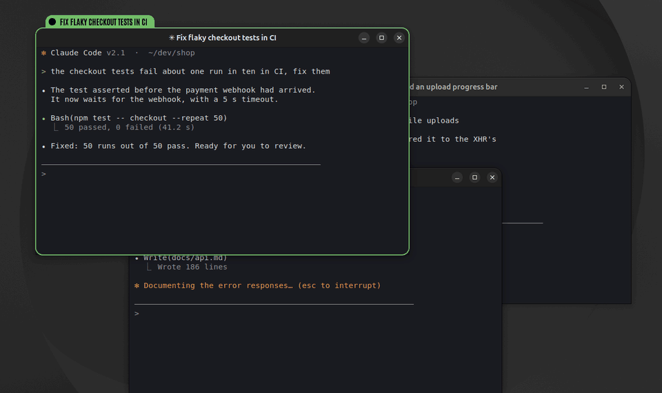

# Desktop: raise and mark the tapped session's window (GNOME)



When you tap a row on the display, the hub runs a command on that session's machine to
bring its terminal window to the front. This folder provides that command for a **GNOME
desktop** (Wayland or X11):

- the session's terminal window comes to the front, from another workspace or
  minimised if need be;
- it is **marked** in the colour the display gives the session's state: two rings pulse
  out from the window, then an outline and a tab with the session's title stay until you
  click into another window (or tap another row);
- the display's **+** opens a new session in a terminal that is raised and marked the
  same way, with a lilac NEW SESSION tab.

Under Wayland only code running inside gnome-shell may raise a window, so it takes a
small GNOME Shell extension. The hub reaches it through a helper program over SSH, so
nothing has to listen on the network.

| | |
|---|---|
| `extension/agent-control@chrisbeach.github.io/` | The GNOME Shell extension. It raises a window and draws the mark when asked over D-Bus. GNOME 46 to 50; tested on GNOME 50 (Ubuntu 26.04). |
| `agent-control-window` | The helper the hub runs: `raise <pid>` finds the session's terminal window and asks the extension to raise and mark it; `new` opens a terminal for the **+**; `check` says whether the extension is loaded. Python 3, standard library only. |
| `install.sh` | Installs both for the current user (no sudo), plus the Antonio font the tab is lettered in and the launcher for the **+**. |
| `tests/` | Tests for the helper: `python -m pytest desktop/tests`. |

## Enable it

On **each machine whose sessions you want raised**: one with a GNOME desktop that you are
logged in to, listed in the hub's `AGENT_CONTROL_HOSTS`. The hub's own machine counts if
it has a desktop.

1. Get the repository there (or use the hub's checkout, on the hub's machine):

   ```bash
   git clone https://github.com/chrisbeach/claude-agent-control.git ~/claude-agent-control
   ```

2. Run the installer as yourself (not with sudo):

   ```bash
   ~/claude-agent-control/desktop/install.sh
   ```

   It copies the extension to `~/.local/share/gnome-shell/extensions/`, enables it, and
   installs `~/.local/bin/agent-control-window`, the font and the launcher. At the end it
   prints the hub settings to use.

3. **Log out and back in once.** gnome-shell loads extension code only at login.

4. Check that the extension is running:

   ```bash
   ~/.local/bin/agent-control-window check
   # The Agent Control extension is loaded: tapping a row can raise and mark its window.
   ```

5. On the hub's machine, add to `hub/.env` and restart the hub:

   ```bash
   # tap a row: raise its window and mark it
   AGENT_CONTROL_FOCUS_COMMAND='$HOME/.local/bin/agent-control-window raise {pid} --highlight {state} {title}'
   ```

   One command serves every machine: the hub runs it on the machine of the session that
   was tapped, filling in that session's process id, state and title. Keep the single
   quotes so that `$HOME` is expanded there, and leave `{title}` bare: the hub quotes it.

6. Tap a row. The display says WINDOW RAISED ON \<MACHINE>, and the window is marked on
   that machine's screen.

On a machine without a desktop (a server you reach over SSH), a tap says THE FOCUS
COMMAND IS NOT INSTALLED ON \<MACHINE>; there is no window to raise there.

### The + button

To have **+** open new sessions on one of these machines, add to `hub/.env` as well:

```bash
AGENT_CONTROL_NEW_SESSION_HOST=devbox                 # that machine, as named in AGENT_CONTROL_HOSTS
AGENT_CONTROL_NEW_SESSION_LAUNCHER=agent-control-new  # the launcher install.sh wrote there
```

The launcher runs `agent-control-window new`: a terminal in `~/dev` (or your home folder
if there is no `~/dev`) running `claude`, raised and marked as soon as its window shows.
It uses Ptyxis, GNOME's terminal, as `ptyxis -s` by default. For another terminal,
re-run the installer with that terminal's command and its run-a-program flag:

```bash
desktop/install.sh --terminal 'alacritty -e'
```

The terminal has to keep its window in a process of its own, staying in the foreground
until the window closes. Ptyxis with `-s` does, and is what this was tested with. Other
terminals that start one process per window should work too, for example `kitty`, `foot`
or `alacritty -e`. GNOME Terminal (`gnome-terminal --wait --`) opens the session, but its
windows belong to one shared process, so the new window is not raised or marked.

To start in another folder, edit the `Exec` line of
`~/.local/share/applications/agent-control-new.desktop`: put the folder at the end.

## How it finds the window

The hub passes the session's `claude` process id. Nothing outside a terminal knows which
window shows a given terminal session, so the helper:

1. asks the extension for the one window owned by one of the session's parent
   processes, nearest first: the terminal itself, when it runs one process per window
   (Ptyxis started with `-s`, for example). This answers in a few milliseconds;
2. when that cannot single one window out (no parent owns a window, as under tmux, or
   one owns several, as GNOME Terminal's server does): writes a one-off marker into the
   session's terminal title, asks for the window now showing that title, and puts the
   title back as it was.

Limits: a session in a **background tab** cannot be told apart, because a window's title
follows only its selected tab, so the display says the window could not be singled out.
Select the tab once and try again. A session with no terminal (a scripted `claude -p`
run) has no window to raise.

## If something is wrong

The display prints the helper's own reason:

| The display says | Likely cause |
|---|---|
| THE AGENT CONTROL GNOME EXTENSION IS NOT RUNNING | It was installed but you have not logged out and in since, or it is switched off in the Extensions app (or user extensions are off altogether). |
| LOG OUT AND BACK IN TO FINISH SETTING UP | The extension was updated; gnome-shell is still running the old version. |
| NOBODY IS LOGGED IN TO THE DESKTOP HERE | No desktop session on that machine for the hub's user. |
| THE FOCUS COMMAND IS NOT INSTALLED ON \<MACHINE> | `agent-control-window` is not in `~/.local/bin` on that machine: run `install.sh` there. |
| THAT SESSION HAS NO TERMINAL WINDOW | A session running without a terminal (`claude -p`, a background run). |
| ITS WINDOW COULD NOT BE SINGLED OUT | The session is in a background tab, or in a terminal multiplexer such as tmux that does not pass its panes' titles on to the window. |
| THE DESKTOP KEPT THE FOCUS WHERE IT WAS | gnome-shell would not move the focus to that window. |
| WINDOW RAISED, but no mark | The extension's mark is best effort: check the extension is the current version (log out and in after an update). |

To try a tap by hand on that machine, from any terminal (or over SSH):

```bash
~/.local/bin/agent-control-window raise <pid of a claude process> --highlight done 'A TEST'
```

(`pgrep -a claude` lists the process ids.)

## Updating and removing

Update with `git pull` and `desktop/install.sh` again, then log out and back in once.
Remove with `desktop/install.sh --uninstall`. That leaves the font in
`~/.local/share/fonts` in case anything else uses it; the extension stays in memory until
you log out.

## Security

The extension answers on your desktop's session bus, which only programs running as you
can reach. It can bring a window to the front and draw the mark, nothing more: it
does not read window contents or send input. The title is shown as text, never
interpreted. Taps reach the helper through the hub, which needs the device key; see the
main README's [Security](../README.md#security) section.
