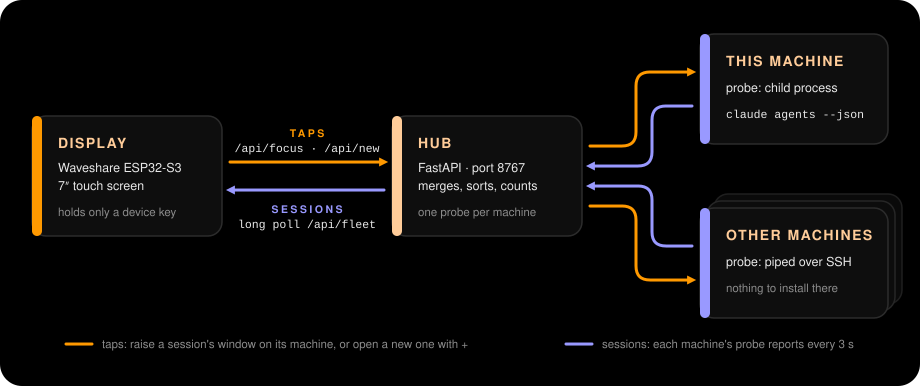

# Hub

A small FastAPI service that knows every live Claude Code session on the machines
you list, and serves them to the display.

- **Probe** (`agent_control/probe.py`, one file, standard library only): prints the
  machine's sessions as a JSON line every few seconds. The list is
  `claude agents --json`, the CLI's machine-readable session list; each session's
  title and whether it has been used come from the Claude Agent SDK when that
  package can be imported, and its token cost and (once it has been used) its last
  turn are read straight from its transcript file.
- **Hub** (`agent_control/hub.py`): keeps one probe running per machine: as a child
  process on its own machine, and as `ssh <host> python3 -` on the others (the script
  is piped over, so nothing has to be installed there). `agent_control/fleet.py` turns
  the reports into what the display prints: upper-cased, sorted, counted.

A remote probe's `ssh` is also that machine's SSH master, with its control socket in
`~/.cache/agent-control/ssh` on the hub's machine. A tap's focus command and the "+"
launcher go down that connection, so they start without a new SSH handshake; when no
probe to that machine is up, they connect on their own. If the hub user's home
directory has too long a path for a Unix socket there (over 37 characters), the log
says so and every command connects on its own.

## Install and run

Needs Python 3.10 or later, and the `claude` CLI on every machine you list.

    cd hub
    python3 -m venv .venv            # Debian/Ubuntu: sudo apt install python3-venv first
    .venv/bin/pip install -r requirements.txt
    mkdir -p ~/.config/agent-control
    python3 -c "import secrets; print(secrets.token_urlsafe(24))" > ~/.config/agent-control/device_key
    chmod 600 ~/.config/agent-control/device_key
    cp .env.example .env             # then edit: at least AGENT_CONTROL_HOSTS
    ./run.sh                         # listens on :8767

Check it from another terminal:

    curl -s localhost:8767/healthz
    curl -s -H "Authorization: Bearer $(cat ~/.config/agent-control/device_key)" localhost:8767/api/fleet

To keep it running, `examples/agent-control.service` is a systemd user unit.

Tests: `.venv/bin/pip install -r requirements-dev.txt && .venv/bin/python -m pytest -q`.

## Configuration

Environment variables, read from `.env` by `run.sh` (all optional; `.env.example`
explains each one):

| Variable | Default | |
|---|---|---|
| `AGENT_CONTROL_HOSTS` | this machine | Machines to show, comma-separated, in display order (at most 6). The others are reached with `ssh <name>` as the hub's user, non-interactively (`BatchMode=yes`), so a key without a passphrase prompt is needed. |
| `AGENT_CONTROL_DEVICE_KEY_FILE` | `~/.config/agent-control/device_key` | The shared secret the display sends as a bearer token. `AGENT_CONTROL_DEVICE_KEY` gives the key itself instead. |
| `AGENT_CONTROL_PORT`, `AGENT_CONTROL_BIND` | `8767`, `0.0.0.0` | Where the hub listens. |
| `AGENT_CONTROL_NEW_SESSION_HOST` | empty (no "+") | The machine whose desktop the display's "+" opens a new session on. |
| `AGENT_CONTROL_NEW_SESSION_LAUNCHER` | empty | The `.desktop` launcher the "+" starts there (its id: `agent-control-new` on a GNOME desktop set up with `desktop/install.sh`, or your own, e.g. `claude-terminal`). |
| `AGENT_CONTROL_FOCUS_COMMAND` | empty (a tap only highlights) | The command a tap runs to raise a session's window, with `{id}`, `{pid}`, `{state}` and `{title}` filled in; see below. |
| `AGENT_CONTROL_CLAUDE` | the `claude` CLI, if found | The CLI that writes the to-do lines. Empty switches them off. |
| `AGENT_CONTROL_PROMETHEUS` | empty (no gauges) | Prometheus base URL for the usage gauges; see below. |
| `AGENT_CONTROL_USAGE_WINDOWS` | `seven_day=WK,seven_day_fable=FB,five_hour=5H` | Which allowance windows get a gauge, in order, and their labels (at most 3). |
| `AGENT_CONTROL_INTERVAL` | `3` | Seconds between probe reports. |

## Endpoints

| | |
|---|---|
| `GET /api/fleet[?rev=…&wait=25]` | The display's view. Bearer = the device key. Given the `rev` it last saw, the answer is held until something changes or `wait` seconds pass. |
| `POST /api/focus?key=…` | Raise that session's window (a tap on its row). Bearer = the device key. Answers `{ok, message}`, the message ready to print. |
| `POST /api/new` | Open a new session (the "+"). Bearer = the device key. Answers `{ok, message}`. |
| `GET /healthz` | Per machine: reporting or not, last error. |
| `GET /metrics` | Prometheus text: loop heartbeat and restarts, per-machine probe state, sessions by state. |

## Session states

In the order the list shows them: `waiting` (blocked on you: a permission prompt, a
question), `failed` (a background session), `done` (it has finished what it was
asked: a result to look at), `working`, `running` (a headless `claude -p` run: alive,
no finer state), `idle` (a session nobody has used yet) and `stopped`.

The CLI has one word, "idle", for every session at rest. The hub calls such a
session `done` when it has been used (it has a transcript, which the Agent SDK finds)
and `idle` when it has not. On a machine where the SDK cannot be imported the probe
cannot tell, and a session at rest becomes `done` only once the hub has itself seen it
working. `done` lasts until the next prompt or the end of the session. A machine whose
probe has been silent for 12 s is shown as OFF and its sessions are withdrawn.

## Titles on other machines

Without the Agent SDK a machine's sessions are listed by name, with no title, no
to-do line and no idle/done distinction. To give a machine the SDK:

    ./bootstrap-host.sh laptop buildbox    # a venv at ~/.local/share/agent-control/venv there, no sudo

It needs Python 3.10 or later on that machine. The SSH probe uses that venv when it
exists. Restart the hub afterwards.

## Tap to raise a window

A tap on a row runs `AGENT_CONTROL_FOCUS_COMMAND` on the session's own machine (in a
shell there, or over SSH), with these filled in:

- `{id}`: the session id (a UUID).
- `{pid}`: the `claude` process id.
- `{state}`: the row's state, one of `working`, `waiting` (shown as NEEDS INPUT),
  `done`, `failed`, `running`, `idle` or `stopped`.
- `{title}`: the row's title as the display shows it (capitals, plain ASCII), already
  shell-quoted into one word by the hub. Use it bare, not inside quotes of your own.

The id and pid are validated before they reach the shell, and the fields are filled
in one pass, so nothing in a title is itself filled in.

- Exit 0: the display shows WINDOW RAISED ON \<HOST>.
- Otherwise the display shows the command's own reason if it printed one on stderr as
  `agent-control: <reason>` (anything after ` — ` is dropped), else COULD NOT RAISE
  THE WINDOW. Exit 127 shows THE FOCUS COMMAND IS NOT INSTALLED ON \<HOST>.

`{state}` and `{title}` let a focus tool mark the window it raised as the row it came
from, for example outline it in the state's colour with the title.

For a GNOME desktop (Wayland or X11), `desktop/` in this repository provides such a
tool: `desktop/install.sh` installs a small GNOME Shell extension (under Wayland only
code inside gnome-shell may raise a window) and the helper the hub runs, which raises
the session's window and marks it that way. Install it on each machine with a desktop,
then set, once for all of them:

    AGENT_CONTROL_FOCUS_COMMAND='$HOME/.local/bin/agent-control-window raise {pid} --highlight {state} {title}'

See [desktop/README.md](../desktop/README.md) for the steps and what its messages mean.
On other desktops the command is yours to write. On X11, something like `wmctrl` or
`xdotool` can find the terminal from the pid's parent process; tmux users can
`tmux switch-client` to the pane running that pid.

## The "+" button: a new session

`agent_control/launch.py` is piped to `python3` on `AGENT_CONTROL_NEW_SESSION_HOST`,
like the probe. It reads the `Exec` line of the `.desktop` launcher named by
`AGENT_CONTROL_NEW_SESSION_LAUNCHER` and starts it as a transient systemd user
service (`systemd-run --user`), so the terminal gets the desktop session's
environment (display, session bus) rather than the SSH connection's, and outlives it.
It answers once the terminal has stayed up for a second; when it cannot (nobody
logged in at the desktop, no such launcher) it says why in one line, which the
display prints. Needs a systemd-based Linux desktop.

On a GNOME desktop, `desktop/install.sh` writes a launcher for this,
`agent-control-new`: a terminal running `claude`, raised and marked like a tapped
session's window ([desktop/README.md](../desktop/README.md)). Elsewhere,
`examples/claude-terminal.desktop` and `examples/claude-terminal.sh` are a starting
point.

## What is left to do

A session that has stopped (DONE, FAILED or NEEDS INPUT) gets a second line: what is
outstanding for you, e.g. "APPROVE GIT PUSH ORIGIN MAIN" or "NOTHING - ALL TESTS
PASS". The probe sends the session's last turn, read from its transcript; if Claude
Code has compacted the session since (it does so to sessions left idle), that is
still the turn before the compaction, not its summary. The hub puts each new turn
once to `claude -p --model haiku` (thinking, tools and MCP off, run in an empty
directory, `~/.cache/agent-control/todo`) and keeps the answer. That is one short
call on your Claude plan per finished turn. A line that starts with NOTHING dims the
row. The hub's own `claude -p` runs are left off the display.

## Usage gauges

The ring gauges show how much of the Claude plan's allowance windows is used. The
hub does not fetch this itself: it reads two series from a Prometheus server, as
published by an exporter you run:

    claude_allowance_used_percent{window="seven_day"}     # percent used, one series per window
    claude_usage_last_fetch_timestamp_seconds             # when the exporter last fetched (epoch seconds)

A figure older than 30 minutes is dropped rather than shown. With
`AGENT_CONTROL_PROMETHEUS` unset there are no gauges, and the rest works the same.
